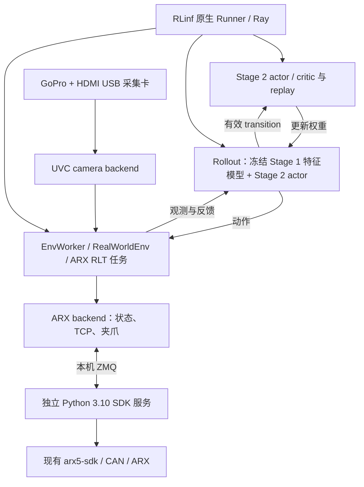

# RLinf 接入 ARX SDK 与 GoPro：RLT Stage 2 评审方案

> 实现更新（2026-09-23）：软件已按本方案接入，当前运行说明见 [ARX Stage 2 指南](../docs/source-zh/rst_source/examples/embodied/arx5_rlt.rst)，验证证据见 [测试报告](ARX_STAGE2_TEST_REPORT.md)。下文保留评审时的设计背景。最终默认执行 H=16；成功／失败立即物理保持，真实完成当前 chunk 的保持尾部后在末步发布一次 done/reward；abort、控制权中断或不可靠数据仍排除。actor 使用可选 EEF reference residual 参数化，人工 BC 保留原 Stage 1 reference 输入。硬件标定和完整 checkpoint 联调仍待完成。

这份方案在 RLinf 原生真机部署和训练流程内接入 ARX 机械臂与 GoPro，完成 RLT Stage 2 在线学习。`umi-arx-deploy` 不作为运行依赖，也不参与部署。当前仅提交设计供评审，尚未修改训练代码、SDK 或启动硬件。

设计依据：`rlinf_evo` 的 `codex/umi-rlt-sft-resume` 分支，提交 `173594b8`；本机 SDK 为 `/home/lenovo/kian/arx5-sdk`。GoPro 接入方式尚待确认，以下相机部分先以 **GoPro → HDMI → USB 采集卡 → Linux V4L2** 为设计基线。

人工介入方式已由用户确认：同一台 ARX 在模型控制和重力补偿拖动之间切换，操作员直接拖动机械臂完成纠正和采数。首版以此作为必需功能，见第 4.4 节。

首版执行方式已确认：保留现有同步 chunk 推理，不修改为异步推理或 RTC。在线训练与训练后评估共用观测、动作执行和拖动接管流程；相机后台采集、SDK 控制及人工接管事件处理按各自时序运行，不引入模型推理与动作 chunk 执行的重叠。

## 1. 架构与复用边界

RLinf 继续负责推理、动作 chunk 执行、Stage 2 actor/critic 更新、replay、权重同步和 checkpoint。新增代码围绕硬件驱动、ARX 任务环境，以及当前 RLT 模型在线输入输出的对接展开。

| 能力 | 处理方式 |
| --- | --- |
| Runner、EnvWorker、RolloutWorker、RLT actor/critic、replay、weight sync | 复用现有实现，不另建部署主循环 |
| 机器人连接生命周期、资源声明与 Ray placement | 复用 `Connection`、`Robot`、`RobotDiscovery` |
| 相机后台采集、重连和基础新鲜度检查 | 复用 `BaseCamera`，补 UVC 驱动与必要时间元信息 |
| episode、键盘、人工接管 | 复用 session、接管标记和 replay；新增同臂重力补偿拖动的模式切换、轨迹采集和控制恢复 |
| ARX 驱动、robot 配置、任务环境 | 新增并注册，继续使用 `env_type: realworld` |
| RLT 模型在线观测、统一动作空间 | 补本次模型与 ARX 的接入，复用现有 RLT 优化目标；额外阶段筛选单独列项 |

源码已经具备上述通用组件和当前模型的 Stage 1 数据处理，在线观测到 Stage 2 的路径仍需对接。要使 Stage 2 训练正确，仅让两个硬件能够通信还不够，必须完成第 4 节的模型输入输出约定。

功能清单中的 episode 控制、人工数据学习及训练/评估属于已有能力的复用与配置，不应作为三套新功能重写。具体边界如下：

| 已有能力 | 本次接入工作 |
| --- | --- |
| 开始/结束、reward/done、RLT 阶段切换、reset 接口及键盘 session | 组合现有事件处理，连接 ARX 的物理 reset 和拖动模式操作；统一按键含义 |
| 人工动作覆盖、逐步接管标记、replay 写入、人工 BC 目标和 critic 更新 | 将实测拖动轨迹按原模型约定编码，填入已有动作和接管字段，验证执行与记录一致 |
| Stage 2 训练入口、通用评估入口、checkpoint 保存/恢复和权重同步 | 补 ARX/GoPro 的硬件、模型及 checkpoint 配置，复用同一环境和同步执行路径 |

关键阶段额外筛选和保留不足 H 的动作段是附加采样行为，分别按第 4.3 节处理，不属于重新实现 replay 或 RLT 学习算法。

## 2. ARX SDK 适配

### 2.1 首版保留现有 SDK 环境

采用 RLinf Python 3.11 → 本机 ZMQ → SDK Python 3.10 的方式。现有 SDK 二进制为 `arx5_interface.cpython-310-x86_64-linux-gnu.so`，SDK 服务继续使用 `/media/lenovo/data/miniconda3/envs/arx-py310`，RLinf 使用已安装的 `.venv`。

这两个进程都在本机运行，Ray 节点数仍为 1。SDK 服务只承担设备控制；模型推理和训练全部由 RLinf 承担。首版不同时实现第二种直连 backend；以后只有在 Python 3.11 SDK 构建验证通过、且实测有需要时再增加。

SDK 服务还需处理独立于模型推理的拖动接管事件，并连续采集带时间戳的机械臂反馈。推理阻塞时也必须能够切入人工模式；RLinf 继续负责观测编码、人工轨迹转换和训练。

### 2.2 原生硬件接口

新增 `Arx5Arm`，注册为 `arx5_zmq` backend，实现 `_open`、`_release`、`get_state` 和 `send_action`。构造对象只保存配置，遵循现有 `connect/disconnect` 生命周期。

- 对 RLinf 暴露 TCP 位姿、关节位置/速度和夹爪宽度。位移统一使用米，角度使用弧度，硬件层 TCP 姿态采用 RLinf 的 `xyzw` 四元数约定。
- 夹爪作为 `arm.end_effector` 复用同一个 SDK 连接，避免两个控制器同时占用 CAN。
- TCP 与 SDK 末端之间的标定变换、夹爪标定、机械臂型号、CAN 接口与限位放入配置。任务坐标与模型的 rot6d 转换不藏在 SDK 驱动内部。
- SDK 不提供的传感量不得用虚构零值冒充有效读数；ARX 任务只声明和消费实际可用字段。
- 补充显式进入拖动、退出拖动并保持当前位置的能力，返回实际模式、切换确认及控制版本号。模型命令携带版本号，人工接管前发出而延迟到达的旧命令必须被拒绝；普通状态读取不得触发模式恢复。

### 2.3 服务端生命周期与错误反馈

在 RLinf `toolkits/realworld_check/` 下提供适配服务入口，调用现有 SDK；不直接把当前示例 ZMQ server 当作训练服务。服务绑定本机地址，约定请求序号、超时、命令接受状态和状态时间戳，使用显式可校验的消息格式。

源码核查发现，当前示例服务无请求超时后会回零并进入阻尼，后续读取可能重建控制器；部分异常还可能留下旧状态。因此服务端设计为：连接/查询不触发回零，启用、任务 reset、保持、故障与恢复各有明确操作。只有已接受的命令更新命令缓存；通信超时、无效状态和 SDK 失败均向环境返回错误。

SDK 已有后台控制与插值，首版由 RLinf 按模型数据时基逐步提交目标，不另造一套轨迹调度框架。分别校验平移、转角和夹爪变化，不能用混合米与弧度的一个范数代替。reset 的完成以位置/速度反馈为准，而非仅以 RPC 返回为准。

SDK 当前 IK 失败路径是否仍提交目标必须在运动联调前验证；若确认，应对 SDK 作最小的拒绝执行/错误传播修复。故障响应优先停止新增轨迹并进入经过实机验证的保持状态；阻尼模式不等于保持，具体降级方式由机械臂承重条件决定。普通状态读取不得解除故障或自动恢复运动。

## 3. GoPro 适配

首版新增 `UVCCamera`，`camera_type: uvc`。GoPro 和采集卡是这份任务配置的设备组合，驱动本身只读取 Linux 视频设备。

- 使用稳定的 `/dev/v4l/by-id/...` 设备标识；显式选择腕部相机，避免绑定到桌面摄像头。
- 配置并核验实际分辨率、帧率和像素格式。驱动沿用 `BaseCamera` 的 BGR、`uint8` 输出；ARX RLT 任务的观测转换负责裁切、必要标定、BGR→RGB 和 224×224 模型输入。
- GoPro 镜头模式、畸变处理、镜像方向和裁切必须与 Stage 1 数据一致。不能仅凭输出尺寸相同就认定输入一致。
- 复用后台线程与连接管理，补充兼容的带时间元信息读帧接口，返回接收时刻、帧序号及健康状态。原有 `get_observation()` 的字段保持兼容。

现有时间戳是主机接收时间，不是 GoPro 曝光时间。环境保存有界机械臂状态历史，根据实测图像延迟和训练时的历史间隔组装观测。复用 `toolkits/realworld_check/measure_camera_latency.py` 测量端到端延迟和抖动，再确定新鲜度阈值及控制周期。

`CAP_PROP_BUFFERSIZE=1` 只能作为请求，不能视为低延迟保证；属性效果依赖实际设备和 backend。[OpenCV 官方说明](https://docs.opencv.org/4.13.0/d4/d15/group__videoio__flags__base.html) 若使用 V4L2 buffer 时间戳，也应记录其时钟与来源，不能直接当成相机曝光时刻。[V4L2 时间戳说明](https://docs.kernel.org/userspace-api/media/v4l/buffer.html)

GoPro/采集卡掉线或图像超过阈值时，中止后续动作执行，保留故障记录，不用无限缓存的旧图像继续学习。重新连接后须重新建立有效历史。若实际接入是 USB Webcam 或网络视频流，则先核实设备暴露方式，再替换本节的 transport backend；上层任务环境和训练流程保持相同。

## 4. RLT 模型的观测、动作与数据处理约定

数据处理以与指定 V4 模型配套的原部署调用链为行为参考，再与采集数据转换逐项对照。已完成的源码和纯函数核查见 [部署与训练 EEF 对照记录](/home/lenovo/mason/code/rlinf_evo/local_setup/OPENPI_DEPLOY_TRAIN_ALIGNMENT.md)。核心相对变换已验证互逆；实际部署配置、图像字段、时序及额外动作补偿仍需核对。当前 `umi-arx-deploy` 的主入口已经采用 ShellGame 观测，不能直接当作本次 V4 的输入接口。

### 4.1 补齐在线观测路径

以用户指定的 OpenPI 训练配置 `pi05_umi_32d_80k_95_real_umi_batch_72_v4` 及其 `LeRobotUmiDataConfigPadded_V4` 为处理依据，复用其模型输入输出、tokenizer、归一化和数据 transforms。`pi05_umi_v4` 是 RLinf 分支中的兼容配置标识；本文将相应处理称为“RLT 模型接口适配”。EEF 处理须与原 OpenPI 流程一致。以下字段、维度、历史状态和动作语义全部保留，描述的是本次模型采用的约定。ARX 环境将真实图像与状态组装为以下字段：

| 字段 | 单样本形状/含义 |
| --- | --- |
| `robot0_eef_pos` | `(2,3)`，两帧位置 |
| `robot0_eef_rot_axis_angle` | `(2,6)`，历史字段名，实际为 6D rotation |
| `robot0_eef_rot_axis_angle_wrt_start` | `(2,6)`，相对 episode 起点的旋转 |
| `robot0_gripper_width` | `(2,1)`，夹爪宽度 |
| `left_wrist_0_rgb_1` | `(224,224,3)` RGB |
| 模型状态 | 两帧各 16 维，经现有处理展平为 32 维 |
| Stage 1 输出 | 网络预测 16 步；32 维内部 action 中有效动作是 10 维 |

当前 `RealWorldEnv._wrap_obs` 和 OpenPI 在线 `repack_env_obs` 尚未传递这套模型观测字段。方案是在现有真机 observation 包装中增加显式、可配置的字段传递，并新增 ARX RLT 任务的 repack 分支；不修改其他任务的默认格式。

Stage 2 的 `proprio_dim` 初版设为 **32**，明确取与 Stage 1 一致的归一化历史状态；`z_dim` 从 Stage 1 checkpoint 配置核对，当前模型配置是 2048。需要为 `extract_rlt_obs` 接入当前模型的观测处理，避免继续沿用 Franka 的 19 维原始状态。

本机用于当前 Stage 1 的数据转换使用旋转矩阵前两行构造 rot6d，而 RLinf 通用 `rot6d.py` 使用前两列。这两种表示不能直接混用。新增任务转换明确采用 checkpoint 对应的行式表示，通过矩阵/四元数与硬件层互转，并用非对称旋转测试验证。

同一个 action chunk 的全部动作使用用于预测的观测时间戳所对应的 TCP 坐标作为固定参考，不能改取推理结束时的 TCP。执行第 2、3 步时，也不能换成最新 TCP 再解码相对位姿。episode 起始参考、观测历史间隔和动作时间间隔都由训练数据契约确定。

用户指定的 `convert_umi_data_to_lerobot_add_target_value.py` 与 `dataset_config.yaml` 实际采样为：当前原始索引 t 的观测取 `[t-3,t]`，动作取 `[t,t+3,…,t+45]`；动作来自记录的 EEF/夹爪轨迹。第一步是当前位姿参考，执行时间对齐必须显式处理这一点。`wrt_start` 在数据转换时带有起点高斯扰动，属于训练增强；原部署 helper 使用实际 episode 起点。原始采集频率和实际 `--fps` 尚需核实，不能由 YAML 中的 `fps:20` 直接推断动作 dt。

当前 YAML 仅生成图像字段 `_0`，而 V4 模型使用 `_1`；应核对实际训练数据 schema 及推理服务的字段映射。上表列的是模型要求，不能据此宣称当前 YAML 原样生成的数据已经满足这些要求。

### 4.2 统一 actor、参考动作、人工动作与 replay 的动作空间

现有 RLT actor 的输出经过 `tanh`，范围是 `[-1,1]`；当前 Stage 1 output transform 返回 10 维物理动作。直接混合二者会让参考动作、BC loss 与执行命令处于不同尺度。

沿用 OpenPI 原本的动作表示和归一化，保留 `action_dim: 10`：

1. Stage 1 reference 使用原 OpenPI 归一化后的动作表示；若取得的是已反归一化的输出，只用原 checkpoint 的同一变换还原到该表示，避免重复归一化。
2. Stage 2 actor 输出、Q 输入、BC 目标、人工接管动作和 replay action 全部对齐该表示。
3. 执行时使用原 OpenPI 反归一化及相对位姿解码，恢复绝对 EEF 目标；ARX backend 负责 SDK 表达与控制点标定转换。

观测与动作均仅对 XYZ 使用原 checkpoint 的各自统计量：优先 min/max，缺失时使用 q01/q99，正常范围的公式为 `2 * (x - lower) / (upper - lower) - 1`，常量维度沿用原实现的处理。rot6d 和夹爪宽度保持原值；原归一化没有 clip。不得另定任务范围替换统计量，也不得将模型的夹爪宽度另映射到 `[-1,1]`。机械臂工作范围和夹爪标定属于执行校验及 SDK 转换，与模型归一化分开。

现有 Stage 2 actor 对所有维度统一使用 tanh 的参数化不能直接视为兼容原 OpenPI 动作表示；接入时应调整 actor 的输出参数化并验证 reference/actor/人工动作一致性，不能为了迁就 actor 改变 EEF 处理约定。具体参数化仍是待验证的 Stage 2 接入项。

原 V4 风格部署入口在解码后另做夹爪阈值映射（小于 0.05 时为 0.011，否则为 0.085）以及绝对 Z 下移 0.008。这些不是训练转换的组成部分，先作为部署补偿记录并核实是否适用于本次硬件，不自动复制。SDK 工具轴旋转、EEF 参考点标定和模型坐标解码分别核对。

模型控制时，rot6d 的正交化或动作限幅若改变实际提交动作，回放必须记录同一动作域中的有效提交动作；同时单独记录实测反馈，不能把“命令已接受”当成“已到达”。重力补偿拖动期间没有模型位置目标下发，人工动作按第 4.4 节由实测轨迹构造，并明确记录来源，不能冒充 SDK 已接受的目标命令。无效旋转、拒绝命令或过期观测不得伪装成正常 transition。actor 的预测、人工接管、实际提交和 replay 的一致性是独立验收项。

若 replay 使用正交化后的 rot6d，训练时 actor/target actor 送入 Q 和 BC 的动作也须采用同一规范化，并验证梯度可用；不能只在环境出口修正。限幅标记与人工接管标记分开保存，避免把自动修正当成人工示范。

### 4.3 时序、奖励与采样规则

首版使用 RLinf 现有同步流程。Stage 1 参考预测长度保持 16；每次实际执行固定窗口 `H≤16` 后重新观测，`H` 和控制周期在核对训练时间间隔、测量本机推理耗时后确定。首次运动验证可从 `H=1` 开始，但这不是最终训练频率承诺，也不修改网络预测长度。RTC 和异步连续推理不列入首版。

初版任务使用人工稀疏奖励与明确的阶段切换，拟定按键：`b` 进入 Stage 2，`c` 成功并结束，`a` 失败并结束；成功 `+1`、失败 `-1`、运行中 `0`。reset 显式执行，人工接管优先于模型动作。具体任务若有可靠自动判定，再替换 reward 来源。

当前 `rlt_policy_switch` wrapper 只处理 `b`，并不同时实现成功/失败奖励；现有配置又一次只选一个 keyboard mode。因此新增一个薄的 RLT session 组合，复用键盘事件与 session 基础设施，统一按键消费。拖动的进入/退出是独立事件，不与 `b` 的 Stage 1/Stage 2 切换混用；触发设备沿用现场按键或脚踏配置。人工接管采用第 4.4 节的同臂重力补偿拖动，替换此前首版默认的 SpaceMouse 方案。

首版复用当前真机 RLT 的轨迹写入方式，人工动作覆盖、接管标记、replay 和 BC/critic 更新均沿用现有实现。此前方案提出的“只把进入 Stage 2 后的 transition 用于训练”属于额外采样规则，不是接入 ARX 或启用人工学习的前提。源码中 `record_transition` 的实际筛选目前走仿真分支；若后续明确采用此规则，才为 ARX 配置补真机筛选，并验证切换边界，不能只设置标志就认为已过滤。

硬件中断与任务失败分别记录；没有可靠 next observation 的动作段不参与更新。当前 `chunk_step` 会遍历整个 chunk，因此任务结束、人工停止或硬件故障必须能阻止剩余命令下发；如通用接口不足，添加显式 opt-in 的 chunk 中断/有效步标记，并验证对其他真机任务无影响。不能把未执行的剩余动作补成正常样本。

当前 chunk 奖励、BC 与 Q 更新按固定 H 计算，首版优先保留这一学习接口。因接管、终止或故障无法构成有效训练样本的未完整动作段，保留原始记录并从训练样本中排除，不能补成已执行动作。若需要保留不足 H 的动作段参与训练，再单独扩展有效步长度、奖励汇总、BC mask 和折扣处理；仅在 env 添加 mask 不足以保证学习正确。H=1 的初始联调可以先验证基本闭环，扩大 H 前再验收完整中断路径。

### 4.4 同一机械臂重力补偿拖动与人工纠正

人工介入时，操作员直接拖动正在执行任务的 ARX。机械臂在这一阶段提供重力补偿并回传真实运动，RLinf 持续采集图像和状态，将人工运动转换为与模型相同表示的训练动作。该功能包括控制权切换和采样路径，不能只把普通遥操作设备的输出替换成当前 EEF 读数后继续下发模型目标。

SDK 已提供基础能力：`teach_replay.py` 先调用 `set_to_damping()`，再降低关节阻尼并记录 EEF/夹爪反馈；控制器在开启 `gravity_compensation` 时持续计算补偿力矩。示例中的 `kd *= 0.1` 仅说明接口用法，首版参数须依据当前机器人、安装方向及负载验证。`set_to_damping()` 本身不会开启重力补偿，而且会同时清零夹爪增益，不能未经处理直接用于持物中的接管。

已有部署工程也提供了拖动行为参考：`Arx5ControllerDirect` 进入拖动后停止下发 TCP 目标，退出时清除旧路点并从当前实测位姿重建插值器。但该路径的 `SingleArm.set_mode(3/4)` 与本机 `arx5-sdk` 的增益接口不同；迁移的是行为约定，具体调用以本机实际 SDK 为准。

原部署 ZMQ client 中的 `SET/GET_GRAVITY_COMPENSATION` 没有对应的本机 SDK 示例 server handler，因此不能视为已接通能力。适配服务需提供完整模式操作，并在退出拖动时刷新目标缓存；原示例的 `last_eef_cmd` 不会随人工运动更新。SDK 示例采集文件也未保存采样时间戳，正式采数须补齐时间元信息。

控制流程设计如下，所有模式均由同一个 SDK 控制器持有 CAN 连接：

| 阶段 | 控制处理 | 数据处理 |
| --- | --- | --- |
| 模型执行 | 执行 Stage 1 reference 或 Stage 2 actor 动作 | 记录观测、有效提交动作、实测反馈及 reward |
| 请求人工接管 | 先禁止新的模型位置命令，作废剩余 chunk 和在途推理结果；SDK 完成重力补偿拖动切换后确认 | 记录接管请求和实际生效时刻；边界步不得错误标为完整人工动作 |
| 人工拖动 | 保持重力补偿与已验证的阻尼；持续读取关节、EEF、夹爪；模型位置目标不得覆盖人工运动 | 连续记录时间戳、图像、实测轨迹和人工标记，按训练时基构造动作段 |
| 交还控制 | 以拖动后的实际关节/EEF/夹爪状态清除并重建目标与插值器，核对后恢复控制增益并保持当前位置 | 结束人工段；保留同一 episode 起始参考，获取新的对齐观测并推理新 chunk |

退出拖动不得恢复旧 chunk、回到接管前位姿或隐式回零。若模式切换失败，保持禁止模型命令并报告失败；SDK 服务只有在切换确认后才报告新模式。恢复增益前须验证当前目标已对齐实测状态，SDK 的位置误差检查不能替代这一流程。

手拖数据采用与原采集转换一致的实测轨迹语义。以某次对齐观测的时刻 `t_obs` 和 EEF 位姿 `T_anchor` 为固定参考，动作第 `k` 个样本取训练约定的目标时刻 `t_obs + k * dt` 的实测位姿与夹爪宽度，用 `inverse(T_anchor) @ T_measured` 编码位置和行式 rot6d，再使用原 checkpoint 的 XYZ 归一化。保留原数据中第一个动作样本位于当前时刻的约定；后续样本必须等真实运动发生并完成时间对齐后构造，不能把每次读取的当前位姿都当成同一观测下的未来动作。硬件坐标转换、图像延迟补偿和历史间隔均复用前述模型接口。

人工段写入逐步 `intervene_flags`，动作来源额外标为实测拖动轨迹，供既有 RLT 人工 BC 目标和 critic replay 使用。原始记录保留模式、有效步、anchor、采样时间及实测 EEF/夹爪，便于核对编码。一次 chunk 中途接管时，已执行模型步保留真实提交动作，后续仅记录实际发生的人工运动或明确截断；未执行的模型尾段不得进入 replay。边界跨步、观测缺失或时间无法对齐的样本必须标记无效，按第 4.3 节的有效长度规则处理。

重力补偿模式切换和原始采样不能依赖模型完成下一次推理。复用 SDK 后台控制、相机采集与有界状态缓冲，增加服务侧接管事件处理以及环境侧人工采样分支；人工阶段可绕过等待模型动作，RLT 特征允许从缓存观测随后提取。同步模型推理仍是首版范围，这项独立接管能力不等同于 RTC，也不要求先实现异步动作 chunk 推理。手拖停顿仍属于人工控制阶段，是否交还控制由显式事件决定，不以“手臂暂时没动”推断退出。

夹爪行为独立配置：持物时保持当前目标/力控制，或按现场方式允许人工调整；持续记录实测夹爪宽度。进入拖动不能因为清零整组增益而意外释放物体。具体触发按键/脚踏、夹爪操作方式及重力补偿负载参数在实机阶段前确认。

本功能的验收覆盖：chunk 中途接管、模型推理等待时接管、连续拖动采样、停止移动后仍保持人工模式、携物接管、交还后不回跳、迟到模型结果被拒绝，以及人工轨迹编码/时间对齐/BC 与 Q 输入一致性。

## 5. 计划代码范围

以下均为拟新增/修改位置，不表示已经实现。实现时优先沿用现有组件，不扩展一套平行框架。

| 路径（相对仓库） | 改动 |
| --- | --- |
| `rlinf/robotics/parts/arms/arx5.py` | ARX ZMQ backend、状态及夹爪接口、拖动模式与控制版本 |
| `rlinf/robotics/robots/arx5.py` | ARX robot、配置、发现与资源注册 |
| `rlinf/robotics/parts/cameras/uvc.py` | UVC 采集驱动 |
| `rlinf/robotics/parts/cameras/base.py` | 必要的兼容时间元信息接口及关闭语义 |
| 对应 `__init__.py` | 注册及延迟导出新增硬件 |
| `rlinf/envs/real/arx5/{base.py,rlt.py,__init__.py}` | ARX RLT task、历史状态、TCP/action 转换、reset、实测拖动轨迹编码 |
| `rlinf/envs/real/env.py`、`rlinf/workers/env/env_worker.py` 及相关采样接入点 | 显式模型观测字段传递、chunk 中断、人工模式采样与迟到推理结果处理 |
| `rlinf/models/embodiment/openpi_rlinf/transforms/env/arx5_rlt.py` 及 dispatch | ARX RLT 任务的在线输入 repack |
| `rlinf/models/embodiment/openpi_rlinf/tasks/eval.py` | 当前模型 proprio 来源与参考动作域对齐 |
| `rlinf/algorithms/rlt/` 中 action codec；现有 route/transition/actor 接入点 | reference/actor/接管/replay 表示一致性；复用已有人工学习路径，额外阶段筛选不列为基础接入项 |
| `rlinf/envs/real/wrappers/episode/`、相关接管接口 | RLT 阶段切换、人工奖励与拖动事件组合，复用接管标记 |
| `toolkits/realworld_check/arx5_server.py` | Python 3.10 SDK 服务、独立接管事件/模式仲裁、连续反馈缓冲及目标重置 |
| `examples/embodiment/config/env/realworld_arx5.yaml` | ARX 任务、相机、控制与 episode 参数 |
| `examples/embodiment/config/realworld_arx5_rlt_stage2_ac_mlp.yaml` | 单机 Stage 2 配置 |
| `evaluations/realworld/realworld_arx5_rlt_eval.yaml` | 训练后固定权重评估配置，复用同一 ARX 环境、模型数据处理和同步执行流程 |
| `requirements/embodied/envs/arx5.txt`、`requirements/install.sh` | 安装目标和依赖说明；SDK 环境独立 |
| 现有 `test_robotics.py`、`test_real_env.py`、`test_models.py`、`test_data.py` | 驱动、模型契约、episode/replay 集成测试 |

如果 SDK 的 IK 失败路径确需修复，将该变更单独列出并保留本机已有标定设置。主仓库新增的代码和配置不导入 `umi-arx-deploy` 或 `openpi-umi`；本机 OpenPI 数据转换源码仅用于核对 Stage 1 语义，运行时复用 RLinf 已有 OpenPI 包。

## 6. 部署配置建议

| 项目 | 首版设计 |
| --- | --- |
| 机器/硬件 | 本机 1 张 RTX 4090、1 台 ARX、1 个腕部 GoPro 视频源 |
| RLinf | `cluster.num_nodes: 1`；actor 与 rollout 使用 GPU 0；env 使用本机 ARX 资源 |
| SDK 服务 | Python 3.10 独立进程，经 loopback 与 RLinf 通信，不作为第二个 Ray 节点 |
| Stage 1 | 当前模型的完整 RLT checkpoint，冻结；BF16 推理能力在加载后单独验证 |
| Stage 2 | 现有 `rlt_ac` 与 `rlt_mlp_policy`；FP32 训练；action 10 维、proprio 32 维 |
| 时间设置 | 参考 horizon 16；执行 H、动作 dt、历史 dt 使用经验证配置 |
| 人工介入 | 同一 ARX 重力补偿拖动，显式进入/退出；夹爪模式单独配置 |
| 启动方式 | 沿用 `examples/embodiment/run_embodiment.sh <新配置名>`；另有 SDK 服务入口 |
| 训练后评估 | 沿用通用评估入口，提供完整 Stage 2 MLP 模型配置和权重路径，同时加载原 Stage 1 特征模型及归一化数据；停止学习更新 |
| 恢复 | 使用原生 checkpoint，同时校验动作 codec、观测规范和任务配置版本一致 |

当前 24 GB 显存是否足够，要以完整 Stage 1 模型与 Stage 2 共存的实测为准；之前小模型环境自检不能代替该验证。安装时已有 OpenPI 进程占用约 18 GB，联调前需要安排显存使用，不会在方案阶段停止它。

## 7. 实施与验收顺序

| 阶段 | 交付物 | 通过条件 |
| --- | --- | --- |
| A：契约冻结 | checkpoint/模型配置、数据时基、GoPro链路、TCP/夹爪标定与任务参数清单 | 必填项明确；用固定观测与动作样本核对行式 rot6d、归一化和 chunk anchor |
| B：两个硬件 backend | ARX driver/SDK服务、UVC driver及配置 | 无硬件测试通过；构造无副作用；超时、断线、错误状态和重复释放均有确定行为 |
| C：ARX RLT 任务闭环 | online repack、动作 codec、session、拖动状态机与 replay 对接 | 录制数据/假设备运行中 reference、actor、实测拖动动作、BC/Q 和 replay 尺度一致；模式切换、迟到命令拒绝及末步语义正确 |
| D：只读实机 | 图像与机械臂状态采集、延迟测量、完整 Stage 1 推理 | 输入与离线基准一致；设备/历史新鲜度达标；模型只预测、不下发动作 |
| E：受控动作 | SDK标定确认、Stage 1参考动作、reset/拖动接管/交还/停止 | 位置/旋转/夹爪方向正确；固定anchor正确；推理等待时仍可接管；携物切换和退出无回跳；故障/结束后无剩余动作继续执行 |
| F：短训练与固定权重评估 | 少量完整episode、更新日志、checkpoint、恢复和评估配置 | 有效transition被采样、损失/梯度有限、actor权重更新并同步；保存恢复成功；评估使用同一数据与控制流程且不更新参数 |

机械臂读写验收与训练结果验收分开。完成 F 证明训练闭环能工作；是否提升任务成功率需要后续对照评估，不能仅凭 loss 下降判断。

## 8. 首版范围与待补参数

首版范围为：**原生 RLinf + ARX ZMQ backend + GoPro/UVC backend + RLT 模型接口适配 + 同臂重力补偿拖动接管**，保留同步推理，组合已有人工 reward/episode 控制，复用 RLT 数据写入和学习流程，并补训练后固定权重评估配置。本方案清单不表示已开始代码实现。

实施前还需补齐：

- GoPro 型号与连接方式；若为采集卡，设备标识、输出模式及 Stage 1 使用的镜头/裁切设置。
- ARX 型号、CAN 通道、TCP 与夹爪标定，以及现有 SDK 的修改基线。
- Stage 1 完整 checkpoint、`norm_stats.json`、实际 V4 部署命令及其 `latest.yaml`、模型服务配置、训练数据 schema 和原始采样频率；核对图像字段及两帧状态/动作的物理时间间隔。
- 本次任务内容、初始姿态/复位方式、拖动进入/退出的现场触发方式、夹爪操作方式、重力补偿负载参数，以及人工成功/失败奖励是否适用。人工介入采用拖动机械臂已确认。

这些缺失参数不影响当前架构评审，但在对应实施阶段结束前必须确定；方案不把未确认值写成可直接控制硬件的默认值。

## 9. 核查依据

- [机器人连接生命周期](/home/lenovo/mason/code/rlinf_evo/rlinf/robotics/parts/base.py)、[BaseArm](/home/lenovo/mason/code/rlinf_evo/rlinf/robotics/parts/arms/base.py)、[机器人注册](/home/lenovo/mason/code/rlinf_evo/rlinf/robotics/discovery/registry.py)。
- [相机基础实现](/home/lenovo/mason/code/rlinf_evo/rlinf/robotics/parts/cameras/base.py)、[Lumos V4L2 示例](/home/lenovo/mason/code/rlinf_evo/rlinf/robotics/parts/cameras/lumos.py)、[相机延迟测量工具](/home/lenovo/mason/code/rlinf_evo/toolkits/realworld_check/measure_camera_latency.py)。
- [当前模型的数据约定](/home/lenovo/mason/code/rlinf_evo/rlinf/models/embodiment/openpi/policies/umi_policy.py:24)、[在线 repack](/home/lenovo/mason/code/rlinf_evo/rlinf/models/embodiment/openpi_rlinf/transforms/env/__init__.py:24)、[RLT 特征提取](/home/lenovo/mason/code/rlinf_evo/rlinf/models/embodiment/openpi_rlinf/tasks/eval.py:122)。
- [指定 OpenPI 训练配置](/home/lenovo/mason/code/openpi-umi/src/openpi/training/config.py:4782)、[原数据处理配置](/home/lenovo/mason/code/openpi-umi/src/openpi/training/config.py:673)、[原 XYZ 归一化](/home/lenovo/mason/code/openpi-umi/src/openpi/transforms.py:298)。
- [当前模型采用的行式 rot6d](/home/lenovo/mason/code/openpi-umi/src/openpi/utils/pose_utils.py:95)、[指定数据转换](/home/lenovo/mason/code/openpi-umi/examples/umi/convert_umi_data_to_lerobot_add_target_value.py:300)、[指定数据配置](/home/lenovo/mason/code/openpi-umi/examples/umi/config/dataset_config.yaml:5)、[RLinf 列式 rot6d](/home/lenovo/mason/code/rlinf_evo/rlinf/utils/rot6d.py:38)。
- [真机动作路由](/home/lenovo/mason/code/rlinf_evo/rlinf/algorithms/rlt/route.py:116)、[actor 输出](/home/lenovo/mason/code/rlinf_evo/rlinf/models/embodiment/mlp_policy/rlt_mlp_policy.py:138)、[replay 接入](/home/lenovo/mason/code/rlinf_evo/rlinf/workers/actor/fsdp_rlt_ac_policy_worker.py:608)。
- [原生 wrapper 组合](/home/lenovo/mason/code/rlinf_evo/rlinf/envs/real/wrappers/__init__.py)、[真机 chunk 执行](/home/lenovo/mason/code/rlinf_evo/rlinf/envs/real/env.py:388)、[本机 SDK 服务源码](/home/lenovo/kian/arx5-sdk/python/communication/zmq_server.py)。
- [SDK 拖动示教](/home/lenovo/kian/arx5-sdk/python/examples/teach_replay.py:16)、[阻尼与插值器重置](/home/lenovo/kian/arx5-sdk/src/app/controller_base.cpp:216)、[重力补偿力矩](/home/lenovo/kian/arx5-sdk/src/app/controller_base.cpp:447)、[恢复增益检查](/home/lenovo/kian/arx5-sdk/src/app/controller_base.cpp:98)。
- [已有拖动停止下发与退出重建](/home/lenovo/mason/code/umi-arx-deploy/modules/arx5_controller_direct.py:472)、[SingleArm 模式接口](/home/lenovo/mason/code/umi-arx-deploy/modules/arx5_single_arm_client.py:324)。这些源码仅作为行为核对依据。
